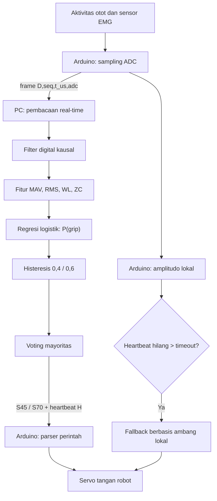

# Tangan Robot Terintegrasi EMG

Proyek ini direncanakan untuk menerjemahkan aktivitas otot lengan bawah menjadi gerakan membuka dan menggenggam pada tangan robot menggunakan satu servo.

Alurnya mencakup pembacaan EMG real-time, filter digital kausal, ekstraksi fitur MAV/RMS/WL/ZC, klasifikasi regresi logistik, serta pengambilan keputusan melalui voting dan histeresis.

> **Status: tahap perencanaan.**
>
> Repositori dan implementasi belum dibuat. README ini menjadi spesifikasi awal untuk menyusun kode, konfigurasi, prosedur rekaman, pengujian, dan dokumentasi.
>
> Struktur folder, nama berkas, serta antarmuka program yang disebut sebagai usulan belum menunjukkan fitur yang sudah tersedia. Perintah instalasi dan eksekusi harus diperiksa setelah implementasi dibuat. Hasil eksperimen belum tersedia.


### Cara membaca penanda

| Penanda | Arti |
|---|---|
| **[BELUM DITENTUKAN]** | Keputusan desain yang masih terbuka |
| **[PERLU KONFIRMASI PERANGKAT]** | Model, pin, tegangan, dan karakteristik sensor/board/servo |
| **[RENCANA IMPLEMENTASI]** | Berkas, fitur, atau perintah yang belum dibuat |
| **[PERLU PENGUKURAN AKTUAL]** | Semua hasil eksperimen |

Selain penanda, README ini memisahkan empat jenis isi:

- **Wajib tugas [6]:** ketentuan dari lembar instruksi UTS. Tidak boleh diubah.
- **Usulan desain:** keputusan awal kelompok. Boleh diubah, tetapi perubahan dicatat di README dan konfigurasi.
- **Belum diketahui:** spesifikasi perangkat. Tidak boleh ditebak.
- **Hasil:** hanya dari pengukuran nyata.

Alur kerja: **README rancangan → pembangunan kode dan struktur repositori → pengujian perangkat → pembaruan README berdasarkan implementasi serta hasil aktual.**

---

## 1. Masalah yang ingin diselesaikan

Ketika kita menggenggam, aktivitas listrik otot berubah. Sensor EMG menangkap aktivitas tersebut dan menghasilkan sinyal yang dapat dibaca oleh sistem akuisisi.

Namun, sinyal yang lebih besar belum otomatis berarti “pengguna ingin menggenggam”. Pembacaan juga dapat dipengaruhi oleh posisi elektroda, kekuatan kontraksi, gerakan kabel, dan gangguan listrik. Perubahan pemasangan elektroda bahkan dapat mengubah performa pengenalan pola EMG [1].

Karena itu, proyek ini tidak langsung menghubungkan satu angka sensor dengan gerakan servo. Sinyal terlebih dahulu diperiksa, disaring, diringkas menjadi fitur, lalu digunakan untuk memperkirakan kondisi otot.

Tujuannya adalah membangun dan mengevaluasi satu rantai lengkap:

1. Membaca EMG secara real-time.
2. Mengurangi gangguan menggunakan filter digital kausal.
3. Menghitung fitur MAV, RMS, WL, dan ZC.
4. Mempelajari perbedaan relax dan grip menggunakan regresi logistik.
5. Menstabilkan keputusan melalui voting dan histeresis.
6. Mengirim perintah membuka atau menggenggam ke servo.
7. Mempertahankan kendali lokal melalui fallback Arduino ketika komunikasi PC terputus.

Setiap tahap memiliki pemeriksaan sendiri. Jika data awal terpotong karena saturasi, classifier yang lebih rumit tidak dapat mengembalikan informasi yang sudah hilang.

## 2. Gambaran alur sistem



Diagram ini **usulan desain**. Urutan yang diusulkan adalah histeresis lalu voting (Bagian 8). Pembagian pemrosesan dan mekanisme fallback ditinjau ulang setelah perangkat diketahui. **[RENCANA IMPLEMENTASI]**

## 3. Sebelum mulai: kenali sinyal yang dibaca

Keluaran sensor EMG dapat berupa sinyal mentah, sinyal yang telah disearahkan, atau envelope, bergantung pada perangkat dan pin yang digunakan. Contoh dokumentasi produsen yang membedakan keluaran tersebut tersedia pada MyoWare [2]. Referensi itu tidak berarti proyek ini memakai MyoWare.

- **Raw EMG:** mempertahankan perubahan cepat sinyal di sekitar suatu baseline.
- **Rectified EMG:** sinyal yang telah disearahkan.
- **Envelope:** representasi perubahan amplitudo aktivitas yang lebih lambat dan halus.

Perbedaan ini menentukan filter dan interpretasi fitur. Misalnya, envelope nonnegatif dapat menghasilkan ZC nol. Hal tersebut tidak otomatis menunjukkan kesalahan program.

**Keluaran yang akan dipakai:** model sensor, pin keluaran, mode sinyal, baseline, dan satuan **[PERLU KONFIRMASI PERANGKAT]**. Kode harus membaca mode ini dari konfigurasi (`sensor.mode = "raw" | "envelope"`, Bagian 10.6), bukan mengasumsikannya.

Jangan menyebut data sebagai tegangan atau raw EMG apabila konversi dan jenis keluarannya belum diketahui. Sampai konversi diketahui, satuan data adalah **hitungan ADC**.

## 4. Tahap pertama: membaca sinyal secara real-time

**Skrip rencana:** `src/tahap1_realtime_plot.py` dan firmware `firmware/emg_hand/emg_hand.ino` **[RENCANA IMPLEMENTASI]**

### Apa yang dilakukan?

Sistem membaca keluaran sensor, mengirimkan data ke komputer, lalu menampilkan perubahan sinyal terhadap waktu.

Bayangkan tahap ini sebagai pemeriksaan mikrofon sebelum merekam suara. Kita perlu memastikan sinyal masuk dengan jelas sebelum mencoba mengenali isinya.

### Input dan output

| Bagian | Isi |
|---|---|
| Input | Keluaran sensor EMG pada pin ADC Arduino **[PERLU KONFIRMASI PERANGKAT]** |
| Proses | Sampling terjadwal di Arduino, pengiriman frame serial (Bagian 10.1), pemeriksaan nomor urut, plot 3 s terakhir dengan offset otomatis |
| Output | Rekaman CSV mentah (Bagian 10.2), ringkasan laju dan saturasi (`outputs/metrics/tahap1_*.json`), tangkapan layar 10 s |

Setiap frame direncanakan membawa **nomor urut, timestamp Arduino, dan nilai ADC**, sehingga kehilangan data dan laju aktual dapat dihitung.

### Mengapa diperlukan?

Angka sampling yang ditulis pada konfigurasi belum membuktikan bahwa komputer menerima data dengan laju tersebut. Data dapat terlambat, hilang, atau menumpuk pada buffer.

Penguatan sensor juga harus cukup untuk membedakan relax dan grip tanpa membuat sinyal menyentuh batas pembacaan.

### Cara memeriksa

- Amati urutan relax–grip–relax.
- Periksa nilai minimum, maksimum, dan kemungkinan clipping.
- Ukur sampel yang benar-benar diterima per detik: `K / Δt` pada sisi PC, dan `(K−1)/(t_K − t_1)` dari timestamp Arduino.
- Hitung frame hilang dari loncatan `seq`.
- Bandingkan RMS segmen relax dan grip menggunakan definisi sinyal yang sama.

Offset otomatis pada grafik hanya membantu tampilan. Data asli tetap disimpan tanpa diubah.

**Usulan desain:** sampling nominal 500 Hz dijadwalkan dengan `micros()` di Arduino. **[BELUM DITENTUKAN]** baud rate, dihitung dari panjang frame maksimum (kapasitas ideal 8N1 ≈ baud/10 byte/s).

**Target tugas:** tanpa saturasi (0/1023), RMS grip/RMS relax ≥ 5×, dan ≥ 490 sampel/s diterima [6].

**Hasil:** [PERLU PENGUKURAN AKTUAL]

## 5. Tahap kedua: membersihkan sinyal dengan filter digital

**Skrip rencana:** `src/tahap2_filter.py`, memakai modul bersama `src/emg/filters.py` **[RENCANA IMPLEMENTASI]**

### Apa yang dilakukan?

Filter mengubah kontribusi komponen frekuensi tertentu pada sinyal.

Secara intuitif, proses ini menyerupai memilih bagian suara yang ingin didengar. Akan tetapi, filter juga dapat mengubah bentuk dan waktu respons sinyal. Karena itu, “grafik terlihat lebih halus” belum cukup sebagai bukti bahwa filter tepat.

### Input dan output

| Bagian | Isi |
|---|---|
| Input | Rekaman CSV mentah dari tahap 1, atau aliran sampel real-time |
| Proses | Filter sesuai mode sensor, dengan keadaan internal (`zi`) dipertahankan antarblok |
| Output | Sinyal terfilter, envelope (jika dipakai), plot Bode/delay/Welch di `outputs/figures/`, koefisien di `outputs/metrics/filter_coeffs.json` |

**Usulan rantai filter awal** (parameter eksplorasi, bukan jaminan target):

| Mode sensor | Rantai usulan |
|---|---|
| Raw | Band-pass Butterworth orde prototipe 2 (orde total 4), 20–200 Hz → notch 50 Hz, Q = 30 → cabang envelope: penyearahan + low-pass orde 1, 15 Hz |
| Envelope | Low-pass sesuai kebutuhan **[BELUM DITENTUKAN]**; sisa 50 Hz tetap dievaluasi; band-pass 20–200 Hz tidak diterapkan otomatis |

Nilai akhir ditetapkan setelah fs aktual dan bandwidth analog sensor diketahui **[PERLU KONFIRMASI PERANGKAT]**.

### Filter kausal

Filter kausal hanya memakai sampel saat ini dan masa lalu. Untuk filter IIR dengan \(a_0=1\), bentuk umumnya:
$$
\[
y[n]=\sum_{k=0}^{M}b_kx[n-k]-\sum_{k=1}^{L}a_ky[n-k].
\]
$$
Di sini:
$$
- \(x[n]\): input filter;
- \(y[n]\): output filter;
- \(b_k,a_k\): koefisien;
- \(M,L\): jumlah lag yang digunakan.
$$
Keadaan filter perlu diteruskan antarblok. Memulai ulang filter pada setiap blok dapat menghasilkan transien berulang. SciPy menyediakan pemrosesan berbasis second-order sections melalui `sosfilt` [3].

Pemrosesan maju–mundur seperti `filtfilt` tidak boleh dijadikan pengganti filter real-time, karena memerlukan sampel dari kedua arah waktu.

**Antarmuka rencana:** satu kelas filter dipakai bersama oleh tahap 2 (analisis offline) dan tahap 4 (real-time), agar perilaku keduanya identik. Contohnya `CausalChain.process(block) -> (y, env)` yang menyimpan `zi` di dalam objek. **[RENCANA IMPLEMENTASI]**

### Frekuensi sampling membatasi rancangan

Frekuensi tertinggi yang dapat direpresentasikan tanpa ambiguitas pada sampling seragam dibatasi oleh Nyquist:
$$
\[
f_\mathrm{Nyquist}=\frac{f_s}{2}.
\]
$$
Sebagai ilustrasi matematika, jika %%\(f_s=500\)$$ Hz, Nyquist adalah 250 Hz. Ini bukan pernyataan bahwa sistem telah mencapai sampling 500 Hz. Kode harus menolak cutoff ≥ Nyquist dari fs yang dikonfigurasi.

Filter analog sebelum ADC juga perlu diperiksa. Filter digital tidak menghapus aliasing yang sudah terjadi saat sampling.

### Cara membaca grafik filter

- **Respons magnitudo:** menunjukkan frekuensi yang dipertahankan atau diredam.
- **Respons fase:** menunjukkan perubahan fase terhadap frekuensi.
- **Delay grup:** menunjukkan keterlambatan komponen sinyal akibat filter.
- **PSD Welch:** membantu membandingkan distribusi daya sebelum dan sesudah pemrosesan [3].

Notch dirancang untuk meredam pita sempit. Pada notch, hubungan faktor kualitas adalah \(Q=f_0/BW\) [3].

Delay grup pada tepat zero notch dapat tidak terdefinisi [3]. Nilai numerik nol pada titik tersebut tidak boleh dipakai sebagai bukti bahwa filter tidak menimbulkan delay.

Jika envelope dibentuk dengan penyearahan, rantai lengkap tersebut mengandung operasi nonlinear. Jangan menyajikan satu Bode seolah seluruh rantai adalah sistem linear.

**Usulan metode redaman 50 Hz:**
$$
\[
A_{50}=10\log_{10}\frac{\int_{49}^{51}P_\mathrm{sebelum}(f)\,df}{\int_{49}^{51}P_\mathrm{sesudah}(f)\,df}\ \text{dB},
\]
$$
dihitung dari rekaman yang sama dengan parameter Welch yang sama.

**[BELUM DITENTUKAN]** pita evaluasi delay grup, parameter Welch (`nperseg`, overlap, window), dan definisi kuantitatif “lubang” envelope. Ketiganya ditetapkan sebelum pengujian.

**Target tugas:** penurunan komponen 50 Hz ≥ 20 dB, delay grup filter < 20 ms, dan envelope halus tanpa lubang saat genggam [6].

**Hasil:** [PERLU PENGUKURAN AKTUAL]

## 6. Tahap ketiga (bagian 1): mengubah potongan sinyal menjadi fitur

**Skrip rencana:** `src/tahap3_learning.py`, memakai `src/emg/features.py` **[RENCANA IMPLEMENTASI]**

Classifier tidak harus menerima setiap sampel secara terpisah. Sinyal dapat dibagi menjadi jendela pendek, lalu diringkas menjadi beberapa angka.

Analogi sederhananya adalah merangkum satu paragraf. Ringkasan membantu pembaca menangkap pola, tetapi selalu membuang sebagian detail. Fitur juga demikian.

**Usulan desain:** jendela kausal 200 ms dengan hop 50 ms. Jumlah sampel \(N\) dan hop dihitung dari fs aktual. Input fitur pada mode raw adalah sinyal terfilter \(y[n]\) sebelum penyearahan, setelah koreksi baseline.

Untuk satu jendela berisi $$\(N\)$$ sampel $$\(x[n]\)$$, fitur yang diwajibkan adalah sebagai berikut [6].

### Mean Absolute Value — MAV
$$
\[
MAV=\frac{1}{N}\sum_{n=1}^{N}|x[n]|.
\]
$$
MAV adalah rata-rata besar amplitudo tanpa memperhatikan tanda positif atau negatif. Nilai ini membantu menggambarkan seberapa besar aktivitas dalam satu jendela.

### Root Mean Square — RMS
$$
\[
RMS=\sqrt{\frac{1}{N}\sum_{n=1}^{N}x[n]^2}.
\]
$$
RMS menguadratkan amplitudo, menghitung rata-ratanya, lalu mengambil akar. Sampel beramplitudo besar mendapat penekanan lebih kuat.

MAV dan RMS sama-sama menggambarkan amplitudo sehingga keduanya dapat saling berkorelasi.

### Waveform Length — WL
$$
\[
WL=\sum_{n=2}^{N}|x[n]-x[n-1]|.
\]
$$
WL menjumlahkan perubahan antar-sampel. Bayangkan mengikuti garis grafik dan mencatat setiap kenaikan serta penurunannya.

WL bukan panjang geometris kurva dalam satuan waktu–amplitudo. Nilainya dipengaruhi panjang jendela, sampling, dan pemrosesan sinyal. Karena itu WL tidak diubah menjadi rata-rata tanpa memperbarui dokumentasi dan melatih ulang model.

### Zero Crossing — ZC
$$
\[
ZC=\sum_{n=2}^{N}\mathbf{1}\left(x[n]x[n-1]<0\land|x[n]-x[n-1]|>thr\right).
\]
$$
ZC menghitung pergantian tanda yang memenuhi ambang perubahan amplitudo.
$$
- \(\mathbf{1}\): bernilai 1 jika kondisi benar, selain itu 0.
- \(thr\): ambang untuk membatasi crossing kecil yang dapat berasal dari noise.
$$
Ambang mempunyai satuan yang sama dengan amplitudo input. Untuk raw EMG, crossing diperiksa terhadap baseline yang sudah dikoreksi. Envelope nonnegatif tidak memberikan informasi crossing yang sama.

**[BELUM DITENTUKAN]** definisi baseline dan cara menentukan $$\(thr\)$$ dari data latih (misalnya kelipatan simpangan baku segmen relax). Nilai akhir disimpan di berkas model (Bagian 10.4).

### Urutan fitur (kontrak)

Urutan fitur di seluruh repositori **wajib sama**:

```text
FEATURE_ORDER = ["MAV", "RMS", "WL", "ZC"]
```

Konstanta ini didefinisikan sekali di modul bersama dan dipakai oleh ekstraksi, pelatihan, penyimpanan model, dan inferensi NumPy. **[RENCANA IMPLEMENTASI]**

### Cara mengetahui fitur masuk akal

- Pilih satu jendela dan hitung fitur secara manual.
- Cocokkan dengan hasil program (rencana: uji unit dengan sinyal kecil yang hasilnya bisa dihitung tangan).
- Periksa satuan dan urutan fitur.
- Buat sebaran fitur untuk relax dan grip.
- Periksa apakah perbedaan kelas berasal dari aktivitas atau artefak.

Sebaran yang terpisah pada data latih belum membuktikan model akan bekerja pada sesi baru.

## 7. Tahap ketiga (bagian 2): regresi logistik, dari fitur menjadi probabilitas grip

Empat fitur digabungkan menjadi:
$$
\[
\mathbf{v}=[MAV,RMS,WL,ZC].
\]
$$
**[BELUM DITENTUKAN]** definisi baseline dan cara menentukan $$\(thr\)$$ dari data latih (misalnya kelipatan simpangan baku segmen relax). Nilai akhir disimpan di berkas model (Bagian 10.4).

Karena skala setiap fitur dapat berbeda, standardisasi digunakan:
$$
\[
\tilde v_j=\frac{v_j-\mu_j}{s_j}.
\]
$$
Rata-rata $$\(\mu_j\)$$ dan skala $$\(s_j\)$$ berasal dari data latih. Data validasi menggunakan parameter yang sama [4]. Fitur yang konstan pada data latih diberi skala 1, seperti perilaku StandardScaler [4].

Model kemudian menghitung:
$$
\[
z=b_0+\sum_{j=1}^{4}w_j\tilde v_j,
\qquad
P(grip)=\frac{1}{1+e^{-z}}.
\]
$$
$$
- \(b_0\): intersep;
- \(w_j\): bobot fitur;
- \(P(grip)\): keluaran probabilitas model untuk kelas grip.
$$
Model dapat dibayangkan sebagai penggabung empat petunjuk. Bobot menunjukkan cara petunjuk tersebut digabungkan setelah pelatihan.

Bobot bukan persentase kontribusi dan tidak otomatis menjelaskan sebab fisiologis. Fitur yang berkorelasi dapat memengaruhi besar maupun tanda koefisien.

**Usulan desain:** encoding kelas `relax = 0`, `grip = 1` (grip = kelas positif). **[BELUM DITENTUKAN]** solver, regularisasi (`C`), dan seed. Semua dicatat di berkas model.

### Pembanding: satu ambang MAV

Pembanding sederhana menggunakan:
$$
\[
\hat y=
\begin{cases}
1,&MAV>T,\\
0,&MAV\leq T.
\end{cases}
\]
$$
Ambang $$\(T\)$$ ditentukan dari data latih pada fold yang sama.

Perbandingan ini menjawab apakah model empat fitur memberi manfaat terhadap aturan amplitudo tunggal. Kedua metode harus diuji pada pembagian data yang sama.

**Hasil perbandingan:** [PERLU PENGUKURAN AKTUAL]

### Inferensi real-time

Instruksi tugas meminta persamaan keputusan real-time dihitung menggunakan NumPy saja [6]. Karena itu, tahap 4 **tidak memuat objek scikit-learn**. Tahap 4 membaca parameter dari berkas JSON (Bagian 10.4) dan menghitung persamaan di atas secara langsung.

Sebelum servo dikendalikan, probabilitas inferensi NumPy dibandingkan dengan `predict_proba` model pelatihan pada input yang sama. **[BELUM DITENTUKAN]** toleransi selisih (usulan: selisih absolut maksimum ≤ 1e-9). **[RENCANA IMPLEMENTASI]**

## 8. Voting dan histeresis: menjaga keputusan tetap stabil

Probabilitas dapat berubah di dekat batas keputusan. Jika servo mengikuti setiap perubahan kecil, gerakannya dapat berulang membuka–menutup.

### Histeresis (wajib tugas)

Instruksi menetapkan [6]:
$$
\[
h_t=
\begin{cases}
1,&P_t>0{,}6,\\
0,&P_t<0{,}4,\\
h_{t-1},&0{,}4\leq P_t\leq0{,}6.
\end{cases}
\]
$$
Histeresis memberi dua batas:

- probabilitas cukup tinggi untuk beralih ke grip;
- probabilitas cukup rendah untuk beralih ke relax;
- daerah di tengah mempertahankan keadaan.

Ini menyerupai pintu yang membutuhkan dorongan lebih kuat untuk berpindah posisi daripada untuk tetap berada di posisi sekarang.

### Voting

Voting mengambil keputusan mayoritas dari beberapa kandidat state terbaru:
$$
\[
q_t=\mathbf{1}\left(\sum_{i=0}^{m-1}c_{t-i}>\frac{m}{2}\right).
\]
$$
Di sini $$\(c_t\)$$ adalah kandidat biner dan $$\(m\)$$ panjang riwayat.

**Usulan desain:**

- Kandidat $$\(c_t = h_t\)$$, yaitu keluaran histeresis. Urutannya: probabilitas → histeresis → voting → state servo.
- $$\(m = 3\)$$. Panjang ganjil dipilih agar tidak ada seri.
- Kondisi awal $$\(h_0 = 0\)$$ (relax). Selama riwayat belum berisi $$\(m\)$$ kandidat, state tetap relax (S45).
- Perintah servo hanya dikirim saat state berubah.

Voting meningkatkan kestabilan dengan menambahkan waktu tunggu sekitar $$\((m-1)\)$$ hop. Karena itu, panjang voting dinilai bersama latensi dan gerakan salah. **[BELUM DITENTUKAN]** nilai $$\(m\)$$ final.

## 9. Dari keputusan ke servo dan fallback

**Skrip rencana:** `src/tahap4_control.py` dan `firmware/emg_hand/emg_hand.ino` **[RENCANA IMPLEMENTASI]**

Instruksi tugas menggunakan [6]:

| Keputusan | Perintah | Setpoint |
|---|---|---:|
| Relax | `S45` | 45° |
| Grip | `S70` | 70° |

Setpoint ini merujuk pada servo, bukan sudut anatomis jari. Gerak aktual dipengaruhi mekanisme tangan robot. API Servo menyediakan perintah posisi, tetapi tidak membuktikan bahwa posisi mekanis sudah tercapai [5].

Protokol perintah dirinci di Bagian 10.1. Pin servo, catu, dan batas mekanis **[PERLU KONFIRMASI PERANGKAT]**.

### Fallback saat PC terputus

Fallback berarti Arduino tetap dapat mengendalikan sistem dengan aturan ambang lokal ketika komunikasi PC hilang.

**Usulan desain:**

| Aspek | Usulan |
|---|---|
| Deteksi putus | PC mengirim `H\n` secara berkala. Arduino mencatat waktu pesan valid terakhir. |
| Periode heartbeat | [BELUM DITENTUKAN], usulan awal 100 ms |
| Timeout | [BELUM DITENTUKAN], usulan awal 3–5× periode heartbeat, ditetapkan dari uji |
| Ukuran amplitudo lokal | Raw: MAV jendela pendek setelah koreksi baseline. Envelope: rata-rata envelope. Bukan satu sampel bertanda. |
| Ambang lokal | Dari kalibrasi anggota sendiri, disimpan di konfigurasi lalu ditanam ke firmware **[BELUM DITENTUKAN]** cara pemindahannya (konstanta kompilasi atau perintah serial) |
| Histeresis lokal | Dua ambang (naik/turun) agar fallback juga tidak bergetar |
| Saat komunikasi pulih | Arduino kembali ke mode PC setelah menerima heartbeat valid, lalu mengirim `M,PC` |
| Daya | Arduino, sensor, dan servo harus tetap mendapat catu saat USB data dilepas **[PERLU KONFIRMASI PERANGKAT]** |

Jika USB PC adalah satu-satunya sumber daya, mencabut USB akan mematikan board. Kondisi itu tidak membuktikan fallback mandiri.

**Status fallback:** [RENCANA IMPLEMENTASI], [PERLU PENGUKURAN AKTUAL]

## 10. Antarmuka antarbagian (kontrak data, usulan)

Bagian ini menjadi kontrak agar keempat skrip, firmware, dan anggota kelompok yang mengerjakannya tetap konsisten. Semua format di bawah adalah **usulan desain**. Jika diubah, ubah README dan kode bersamaan.

### 10.1 Protokol serial

Semua pesan berupa ASCII, satu pesan per baris, diakhiri `\n`. Konfigurasi 8N1. Baud **[BELUM DITENTUKAN]**.

**Arduino → PC**

| Pesan | Arti |
|---|---|
| `D,<seq>,<t_us>,<adc>` | Satu sampel. `seq` bilangan bulat naik (boleh wrap), `t_us` = `micros()` saat sampling, `adc` = nilai ADC mentah |
| `A,<cmd>` | Konfirmasi perintah servo diterima, misalnya `A,S70` |
| `M,<mode>` | Perubahan mode kendali: `PC` atau `FALLBACK` |
| `# <teks>` | Pesan informasi/debug. PC mengabaikannya dalam perhitungan |

**PC → Arduino**

| Pesan | Arti |
|---|---|
| `S45` | Servo ke setpoint 45° (relax) |
| `S70` | Servo ke setpoint 70° (grip) |
| `H` | Heartbeat |

Pesan lain diabaikan oleh Arduino dan tidak menggerakkan servo. Setpoint di firmware dibatasi pada rentang 45°–70°.

Timestamp Arduino (`t_us`) dan timestamp PC (`t_pc_ns`) berasal dari clock berbeda. Keduanya tidak langsung dikurangkan tanpa pemetaan.

### 10.2 Rekaman mentah

Satu berkas per blok rekaman:

```text
data/raw/<subject_id>_<session_id>_<block_id>.csv
```

Kolom:

```text
seq,t_us,adc,t_pc_ns
```

- `subject_id`: kode anonim, misalnya `P01`. Nama asli tidak muncul di repositori.
- `session_id`: `S1` atau `S2`.
- `block_id`: `B01`, `B02`, …

Data ADC asli tidak diubah. Koreksi baseline dan filter hanya dilakukan pada salinan di `data/processed/`.

### 10.3 Manifest rekaman

`data/manifest.csv`, satu baris per segmen berlabel:

```text
file,subject_id,session_id,block_id,label,t_start_s,t_end_s,valid,exclusion_reason,fs_nominal,sensor_mode,gain_setting,electrode_photo,notes
```

- `label`: `relax` atau `grip`.
- `t_start_s`, `t_end_s`: batas segmen valid relatif terhadap awal berkas, di luar masa transisi.
- `valid`: `1` atau `0`. Jika `0`, `exclusion_reason` wajib diisi.

Label berasal dari instruksi protokol dan anotasi, bukan dari prediksi classifier.

### 10.4 Fitur dan model

**Tabel fitur** `data/processed/features.csv`:

```text
subject_id,session_id,block_id,label,window_end_seq,MAV,RMS,WL,ZC
```

**Model logistik** `models/logreg_<versi>.json`:

```json
{
  "feature_order": ["MAV", "RMS", "WL", "ZC"],
  "label_encoding": {"relax": 0, "grip": 1},
  "mu": [0, 0, 0, 0],
  "scale": [1, 1, 1, 1],
  "weights": [0, 0, 0, 0],
  "intercept": 0,
  "zc_thr": 0,
  "window": {"N": 0, "hop": 0, "fs": 0},
  "filter_config": "config/system.toml",
  "train_data": {"sessions": ["S1"], "subjects": []},
  "solver": "", "C": 0, "seed": 0,
  "versions": {"python": "", "numpy": "", "scikit-learn": ""},
  "created_at": ""
}
```

Angka `0` dan string kosong di atas hanya **contoh bentuk**, bukan parameter model.

**Pembanding MAV** `models/mav_threshold_<versi>.json`, berisi `T`, satuan, dan data latih yang dipakai.

### 10.5 Log kontrol

`outputs/logs/kontrol_log.csv`, satu baris per jendela fitur:

```text
subject_id,session_id,trial_id,t_pc_ns,seq,t_us,MAV,RMS,WL,ZC,p_grip,h_hyst,vote_state,servo_cmd,mode,heartbeat_age_ms,event_note
```

- `servo_cmd`: kosong jika tidak ada perintah terkirim pada jendela itu.
- `mode`: `PC` atau `FALLBACK` (dari pesan `M`).
- Waktu awal gerak jari dari anotasi video disimpan terpisah di `outputs/logs/latensi_anotasi.csv` dengan kunci `trial_id`.

### 10.6 Konfigurasi

`config/system.toml` (TOML dibaca dengan `tomllib` bawaan Python ≥ 3.11). Bagian yang direncanakan:

```toml
[serial]
port = "[PERLU KONFIRMASI PERANGKAT]"
baud = 0                      # [BELUM DITENTUKAN]

[sensor]
mode = "raw"                  # "raw" atau "envelope", [PERLU KONFIRMASI PERANGKAT]
adc_min = 0
adc_max = 1023                # acuan tugas; sesuaikan bila ADC berbeda

[sampling]
fs_nominal = 500              # usulan desain

[filter]
bandpass_hz = [20, 200]       # usulan, hanya mode raw
bandpass_order = 2            # orde prototipe
notch_hz = 50
notch_q = 30
envelope_lp_hz = 15

[features]
window_ms = 200
hop_ms = 50

[decision]
p_grip_on = 0.6               # wajib tugas
p_grip_off = 0.4              # wajib tugas
vote_length = 3               # usulan

[control]
heartbeat_ms = 100            # usulan
```

Nilai di atas adalah usulan awal. Port serial tidak ditebak dan harus diisi oleh pengguna.

## 11. Usulan struktur direktori

```text
[folder-proyek]/
├── README.md
├── requirements.txt                 # Dependensi setelah implementasi ditetapkan
├── .gitignore
├── config/
│   └── system.toml                  # Konfigurasi perangkat dan pemrosesan (10.6)
├── firmware/
│   └── emg_hand/
│       └── emg_hand.ino             # Sampling, parser S45/S70/H, watchdog, fallback
├── src/
│   ├── tahap1_realtime_plot.py
│   ├── tahap2_filter.py
│   ├── tahap3_learning.py
│   ├── tahap4_control.py
│   └── emg/                         # Modul bersama
│       ├── serial_link.py           # Parser frame 10.1, deteksi seq hilang
│       ├── filters.py               # Rantai filter kausal dengan state
│       ├── features.py              # MAV, RMS, WL, ZC + FEATURE_ORDER
│       ├── decision.py              # Sigmoid NumPy, histeresis, voting
│       └── io_utils.py              # Baca/tulis CSV, manifest, model JSON
├── tests/                           # Uji unit fitur, filter, keputusan
├── data/
│   ├── raw/
│   ├── processed/
│   └── manifest.csv
├── models/
├── outputs/
│   ├── figures/
│   ├── metrics/
│   └── logs/
└── docs/
    └── [protokol rekaman, panduan pengujian, logbook]
```

Struktur tersebut **usulan desain**. Nama empat skrip mengikuti penamaan pada instruksi tugas [6]. Nama folder firmware dibuat sama dengan nama berkas `.ino` karena Arduino IDE mensyaratkannya. Detail modul bersama dapat berubah saat implementasi.

Data identitas dan formulir bertanda tangan **tidak** disimpan di repositori. Simpan terpisah dengan akses terbatas. `.gitignore` direncanakan mengecualikan berkas tersebut.

**Pemetaan komponen ke lokasi (rencana):**

| Komponen | Lokasi rencana | Penanggung jawab |
|---|---|---|
| Akuisisi dan plot real-time | `src/tahap1_realtime_plot.py`, `src/emg/serial_link.py` | [BELUM DITENTUKAN] |
| Filter dan analisis frekuensi | `src/tahap2_filter.py`, `src/emg/filters.py` | [BELUM DITENTUKAN] |
| Ekstraksi fitur dan pelatihan | `src/tahap3_learning.py`, `src/emg/features.py` | [BELUM DITENTUKAN] |
| Inferensi dan kontrol real-time | `src/tahap4_control.py`, `src/emg/decision.py` | [BELUM DITENTUKAN] |
| Firmware Arduino | `firmware/emg_hand/` | [BELUM DITENTUKAN] |
| Konfigurasi dan dependensi | `config/`, `requirements.txt` | [BELUM DITENTUKAN] |
| Data, model, grafik, log | `data/`, `models/`, `outputs/` | Semua |
| Dokumentasi dan video | `README.md`, `docs/` | [BELUM DITENTUKAN] |

Instruksi tugas mewajibkan tiap anggota menjadi penanggung jawab utama satu tahap [6].

## 12. Perangkat yang diperlukan

### Perangkat keras

Hanya perangkat yang disediakan lab yang dipakai; tidak ada nilai tambah untuk perangkat lain [6].

| Komponen | Informasi yang harus diverifikasi |
|---|---|
| Sensor EMG | Model, mode output, gain, tegangan dan bandwidth **[PERLU KONFIRMASI PERANGKAT]** |
| Elektroda | Jenis dan konfigurasi pemasangan **[PERLU KONFIRMASI PERANGKAT]** |
| Arduino | Model, ADC, tegangan referensi dan komunikasi **[PERLU KONFIRMASI PERANGKAT]** |
| Servo/tangan robot | Model, catu, pin, mekanisme dan batas gerak **[PERLU KONFIRMASI PERANGKAT]** |
| Komputer | Sistem operasi dan antarmuka komunikasi **[PERLU KONFIRMASI PERANGKAT]** |
| Catu serta kabel | Spesifikasi dan koneksi sesuai perangkat **[PERLU KONFIRMASI PERANGKAT]** |

### Perangkat lunak (rencana)

| Komponen | Kegunaan rencana |
|---|---|
| Python ≥ 3.11 | Bahasa utama; `tomllib` bawaan untuk konfigurasi |
| NumPy | Fitur dan inferensi real-time |
| SciPy | Desain dan penerapan filter, Bode, delay grup, Welch |
| scikit-learn | Pelatihan regresi logistik, scaler, CV (hanya tahap 3) |
| pySerial | Komunikasi serial [7] |
| matplotlib | Plot real-time dan grafik bukti |
| Arduino IDE/CLI + pustaka Servo | Firmware [5] |

Pustaka ini sesuai daftar pustaka standar yang diizinkan tugas [6]. Versi yang benar-benar terpasang dicatat di `requirements.txt` dan berkas model setelah implementasi. **[RENCANA IMPLEMENTASI]** Jangan menganggap versi dokumentasi daring sama dengan versi lingkungan proyek.

## 13. Instalasi dan menjalankan proyek (alur rencana)

Semua perintah di bagian ini **[RENCANA IMPLEMENTASI]**. Perintah belum dapat dijalankan karena berkasnya belum ada, dan harus diverifikasi setelah kode dibuat.

### A. Persiapan

1. Dapatkan repositori: URL dan metode akses [BELUM DITENTUKAN].
2. Buat lingkungan Python, lalu pasang dependensi dari `requirements.txt` setelah berkas itu dibuat.
3. Buka `firmware/emg_hand/emg_hand.ino`, pilih board, lalu unggah firmware **[PERLU KONFIRMASI PERANGKAT]**.
4. Isi `config/system.toml`: port, baud, mode sensor, dan parameter lain.

### B. Jalankan secara bertahap

| Tahap | Perintah rencana | Pemeriksaan sebelum lanjut |
|---|---|---|
| Akuisisi | `python src/tahap1_realtime_plot.py --config config/system.toml --record P01_S1_B01` | Data diterima, laju ≥ 490/s, tanpa saturasi |
| Filter | `python src/tahap2_filter.py --input data/raw/P01_S1_B01.csv` | Filter sesuai mode, Bode/Welch/delay tersimpan |
| Rekaman/pelatihan | `python src/tahap3_learning.py --manifest data/manifest.csv` | Split blok, CV, uji sesi 2, model JSON tersimpan |
| Kontrol | `python src/tahap4_control.py --model models/logreg_<versi>.json` | Uji kecocokan NumPy lulus, mekanisme siap, state awal relax |
| Fallback | Lepas kabel data PC saat `tahap4_control.py` berjalan, dengan catu lokal tetap aktif | Arduino mengirim `M,FALLBACK` dan servo tetap merespons |

Nama argumen di atas adalah usulan antarmuka. Contoh keluaran terminal ditambahkan setelah program benar-benar berjalan.

**Keselamatan:** `tahap4_control.py` menggerakkan aktuator. Jalankan hanya setelah mekanisme diperiksa dan sesuai prosedur lab (Bagian 17).

## 14. Rekaman relax–grip dan pemisahan data

Instruksi meminta minimal dua anggota kelompok sendiri, persetujuan tertulis, serta dua sesi dengan pelepasan dan pemasangan ulang elektroda. Data kelompok lain tidak boleh dipakai untuk pelatihan [6].

Rencana konservatif adalah merekam setidaknya **20 detik data valid per kelas, per orang, per sesi**. Ini merupakan operasionalisasi protokol, bukan laporan durasi aktual. Usulan: minimal empat blok terpisah per kelas, masing-masing ±5 s valid, agar CV berbasis blok dapat dilakukan.

Untuk setiap rekaman, catat di manifest (Bagian 10.3):

- kode subjek, sesi, kelas dan blok;
- posisi elektroda (foto) dan postur;
- sampling serta mode sensor;
- waktu transisi dan istirahat;
- durasi valid;
- alasan pengecualian data.

### Menghindari kebocoran data

Jendela yang saling overlap berbagi sampel. Jika dibagi secara acak ke train dan validasi, evaluasi dapat terlihat terlalu baik.

Gunakan pembagian berbasis blok atau kelompok yang sesuai [4]:

1. Tetapkan blok sebelum membuat jendela.
2. Pertahankan seluruh jendela satu blok dalam partisi yang sama.
3. Hindari jendela yang menyeberangi batas partisi.
4. Fit scaler, \(thr\) ZC, dan ambang MAV hanya pada train.
5. Gunakan split yang sama untuk logistik dan pembanding MAV.

**Usulan desain:** CV 4-fold berbasis grup (subjek + blok) pada sesi 1, dengan syarat setiap fold berisi kedua kelas. **[BELUM DITENTUKAN]** jumlah fold final dan seed. Indeks fold disimpan di `outputs/metrics/cv_folds.csv` agar dapat diaudit.

### Sesi kedua sebagai uji terpisah

Gunakan sesi pertama untuk pengembangan dan CV. Setelah pipeline dipilih, latih ulang pada seluruh sesi 1, bekukan model serta preprocessing, lalu uji sesi kedua satu kali.

Jangan menyesuaikan model berdasarkan sesi kedua lalu tetap menyebut hasilnya sebagai pengujian independen.

Pengujian dua sesi pada anggota yang sama menilai ketahanan terhadap pemasangan ulang. Itu belum membuktikan kemampuan pada pengguna baru.

## 15. Bukti yang harus dihasilkan implementasi

Reproduksi berarti pembaca dapat mengikuti asal data hingga grafik dan metrik, bukan hanya melihat gambar akhir. Tabel berikut adalah keluaran yang **harus** dihasilkan kode nanti.

| Bukti | Input | Skrip rencana | Lokasi output rencana |
|---|---|---|---|
| Plot EMG 10 s relax–grip–relax | Rekaman mentah | `tahap1_realtime_plot.py` | `outputs/figures/tahap1_10s.png` |
| Laju, frame hilang, saturasi, RMS | Rekaman mentah | `tahap1_realtime_plot.py` | `outputs/metrics/tahap1_summary.json` |
| Bode, fase, delay grup | Koefisien + fs | `tahap2_filter.py` | `outputs/figures/tahap2_bode.png` |
| Welch sebelum/sesudah, A₅₀ | Rekaman sama | `tahap2_filter.py` | `outputs/figures/tahap2_welch.png`, `outputs/metrics/tahap2_summary.json` |
| Mentah vs terfilter vs envelope | Rekaman relax–grip | `tahap2_filter.py` | `outputs/figures/tahap2_envelope.png` |
| Sebaran fitur | `features.csv` | `tahap3_learning.py` | `outputs/figures/tahap3_features.png` |
| CV + confusion matrix (logistik vs MAV) | Sesi 1 + fold | `tahap3_learning.py` | `outputs/metrics/tahap3_cv.json`, `outputs/figures/tahap3_cm.png` |
| Evaluasi sesi kedua | Model beku + sesi 2 | `tahap3_learning.py` | `outputs/metrics/tahap3_session2.json` |
| Log kontrol | Eksekusi kontrol | `tahap4_control.py` | `outputs/logs/kontrol_log.csv` |
| Latensi 20 kontraksi | Log + anotasi video | [BELUM DITENTUKAN] | `outputs/metrics/tahap4_latency.csv` |
| Genggam 3 benda × 10 | Lembar uji | Manual | `outputs/metrics/tahap4_grip.csv` |

Jika sebagian analisis tetap manual, langkah manualnya ditulis di `docs/`. Jangan mengklaim seluruh reproduksi otomatis.

### Video demo

Video dibuat dari pengujian perangkat aktual, bukan dihasilkan ulang dari dataset saja. Durasi maksimum tiga menit [6]. Alur yang disarankan:

- tunjukkan rangkaian dan penempatan elektroda;
- tampilkan relax–grip–relax;
- tunjukkan pengolahan dan keputusan;
- demonstrasikan servo serta genggam;
- tunjukkan fallback;
- tampilkan ringkasan metrik yang sudah diukur.

Tautan video: [BELUM DITENTUKAN]

Video ringkas tidak menggantikan log percobaan lengkap.

## 16. Membaca hasil dan membandingkannya dengan target

| Metrik | Target tugas [6] | Hasil/status |
|---|---|---|
| Saturasi | Tanpa saturasi; acuan tugas 0/1023 | [PERLU PENGUKURAN AKTUAL] |
| RMS grip/RMS relax | ≥ 5× | [PERLU PENGUKURAN AKTUAL] |
| Sampel diterima | ≥ 490 sampel/s | [PERLU PENGUKURAN AKTUAL] |
| Penurunan 50 Hz | ≥ 20 dB | [PERLU PENGUKURAN AKTUAL] |
| Delay grup filter | < 20 ms | [PERLU PENGUKURAN AKTUAL] |
| Envelope saat grip | Halus tanpa lubang | [PERLU PENGUKURAN AKTUAL] |
| Akurasi CV | ≥ 95 % | [PERLU PENGUKURAN AKTUAL] |
| Akurasi sesi kedua | ≥ 85 % | [PERLU PENGUKURAN AKTUAL] |
| Latensi | p95 < 400 ms; 20 kontraksi | [PERLU PENGUKURAN AKTUAL] |
| Keberhasilan genggam | ≥ 80 %; 3 benda × 10 uji | [PERLU PENGUKURAN AKTUAL] |
| Gerakan salah | ≤ 3 per 2 menit | [PERLU PENGUKURAN AKTUAL] |
| Fallback | Tetap bekerja saat PC diputus | [PERLU PENGUKURAN AKTUAL] |

Jika ADC aktual berbeda dari acuan 10-bit, jelaskan rentang native dan pemetaannya.

### Apa arti metrik tersebut?

Akurasi:

\[
Accuracy=\frac{TP+TN}{TP+TN+FP+FN}.
\]

Grip adalah kelas positif sesuai encoding usulan (Bagian 7). Confusion matrix membantu membedakan grip yang terlewat dan relax yang salah dianggap grip.

Latensi tugas diukur dari **onset kontraksi hingga awal gerak jari**. Waktu sampai pengiriman perintah hanya mengukur sebagian rantai. Laporkan median, p95, metode kuantil, sinkronisasi, dan resolusi waktu. Dengan 20 percobaan, metode kuantil perlu ditulis agar hasil dapat dibuat ulang.

Keberhasilan genggam:

\[
Success=\frac{n_\mathrm{berhasil}}{n_\mathrm{uji}}\times100\%.
\]

**[BELUM DITENTUKAN]**, dan wajib ditetapkan sebelum uji:

- definisi onset kontraksi dan awal gerak;
- metode sinkronisasi log dengan video;
- tiga benda (identitas, dimensi, massa);
- kriteria genggam berhasil (usulan: benda terangkat dan bertahan 5 s tanpa jatuh);
- definisi event gerakan salah (usulan: satu transisi state mekanis yang bertentangan dengan kondisi berlabel, bukan setiap jendela yang salah prediksi).

Gunakan status “belum diuji”, “memenuhi”, “belum memenuhi”, atau “belum dapat diverifikasi”. Data kosong bukan nilai nol.

## 17. Keterbatasan dan keselamatan

### Keterbatasan yang sudah dapat diperkirakan

- Posisi elektroda dan usaha kontraksi dapat mengubah sinyal.
- Mode envelope membatasi informasi yang tersedia bagi fitur tertentu.
- Akurasi offline tidak menjamin kendali mekanis yang baik.
- Filter, windowing dan voting menambah waktu respons.
- Setpoint servo tidak sama dengan pengukuran posisi jari.
- Dua subjek dan dua sesi tidak mewakili seluruh calon pengguna.
- Prototipe ini belum dapat disebut alat klinis atau prostesis tervalidasi.

Keterbatasan aktual ditambahkan setelah implementasi dan pengujian: [PERLU PENGUKURAN AKTUAL].

### Keselamatan penggunaan

- Ikuti manual sensor dan prosedur keselamatan lab untuk perangkat yang terhubung ke tubuh.
- Verifikasi catu, grounding, dan kebutuhan isolasi sebelum pemasangan elektroda.
- Jangan mengasumsikan semua kombinasi USB, charger, dan catu eksternal aman digunakan pada tubuh.
- Periksa batas gerak dan jauhkan bagian tubuh dari mekanisme yang dapat menjepit.
- Hentikan percobaan jika timbul iritasi, nyeri, atau ketidaknyamanan.
- Gunakan persetujuan subjek dan batasi akses data identitas.
- Jangan mengunggah formulir bertanda tangan ke repositori publik.

Prosedur daya dan keselamatan sesuai manual aktual: **[PERLU KONFIRMASI PERANGKAT]**.

### Rencana pengembangan

Rencana berikut disesuaikan dengan hasil baseline:

| Pengembangan | Ukuran evaluasi | Target yang disepakati |
|---|---|---|
| Kalibrasi lebih cepat | Durasi dan performa sesi baru | [BELUM DITENTUKAN] |
| Respons lebih cepat/stabil | p95, keberhasilan, gerakan salah | [BELUM DITENTUKAN] |
| Gestur tambahan atau kontrol proporsional | Metrik sesuai tugas baru | [BELUM DITENTUKAN] |

Jangan menuliskan rencana sebagai fitur yang sudah tersedia.

## 18. Kontributor dan lisensi

| Kontributor | Tahap yang dipimpin | Bukti kontribusi |
|---|---|---|
| [BELUM DITENTUKAN] | [BELUM DITENTUKAN] | Commit, logbook, presentasi |

Kontribusi perlu sesuai commit, logbook, dan pembagian tugas. Penilaian individu dapat berbeda ± 10 poin dari nilai kelompok [6].

**Lisensi:** [BELUM DITENTUKAN]. Periksa ketentuan kode acuan kelas sebelum menetapkan lisensi. Tanpa lisensi yang diketahui, jangan menyatakan kode bebas digunakan.

## 19. Referensi

[1] D. Tkach, H. Huang, dan T. A. Kuiken, “Study of stability of time-domain features for electromyographic pattern recognition,” *Journal of NeuroEngineering and Rehabilitation*, vol. 7, art. 21, 2010.
https://doi.org/10.1186/1743-0003-7-21

[2] Advancer Technologies, “MYOWARE® 2.0 Muscle Sensor.” Rujukan contoh mode output; bukan identifikasi sensor proyek.
https://myoware.com/products/muscle-sensor/

[3] SciPy Developers, “Signal processing (scipy.signal): butter, sosfilt, iirnotch, group_delay, welch,” SciPy API Reference.
https://docs.scipy.org/doc/scipy/reference/signal.html

[4] scikit-learn Developers, “StandardScaler,” “LogisticRegression,” “Common pitfalls and recommended practices,” dan “Cross-validation: evaluating estimator performance,” scikit-learn API Reference dan User Guide.
https://scikit-learn.org/stable/

[5] Arduino, pustaka resmi Servo, `src/Servo.h`.
https://github.com/arduino-libraries/Servo/blob/master/src/Servo.h

[6] R. Wicaksono, “Tugas Proyek Ujian Tengah Semester: Sistem Instrumentasi Biomedis Cerdas (SIBC) 2026—Tangan Robot Terintegrasi EMG,” lembar instruksi kelas dua halaman, DTETI FT UGM, 2026. Tidak tersedia URL publik. Lokasi salinan di repositori: [BELUM DITENTUKAN].

[7] pySerial Developers, “pySerial API.”
https://pyserial.readthedocs.io/en/latest/pyserial_api.html

Tanggal akses sumber daring: 25 Oktober 2026. Halaman dokumentasi dari sumber yang sama digabung menjadi satu entri, sama seperti laporan PDF.

Tambahkan manual sensor, board, dan servo aktual setelah model perangkat diketahui **[PERLU KONFIRMASI PERANGKAT]**. Ganti atau hapus [2] bila sensor yang dipakai bukan MyoWare.

## 20. Checklist sebelum demo dan pengumpulan

- [ ] Identitas perangkat, mode output dan konfigurasi sesuai kondisi aktual.
- [ ] README diperbarui: penanda [RENCANA IMPLEMENTASI] diganti perilaku kode nyata.
- [ ] Perintah instalasi dan eksekusi sudah diuji.
- [ ] Tahap akuisisi, filter, learning dan kontrol dapat dijalankan berurutan.
- [ ] Data kelompok sendiri dan persetujuan tertulis tersedia.
- [ ] Sesi kedua benar-benar melalui lepas-pasang elektroda.
- [ ] CV tidak membocorkan jendela/blok atau preprocessing.
- [ ] Logistik dibandingkan dengan ambang MAV pada split yang sama.
- [ ] Parameter inferensi NumPy cocok dengan model terlatih.
- [ ] Voting, histeresis, S45/S70 dan kondisi awal terdokumentasi.
- [ ] Bukti 20 kontraksi, 30 uji genggam dan dua menit gerakan salah tersedia.
- [ ] Fallback diuji dengan daya yang tetap tersedia.
- [ ] Semua hasil dapat ditelusuri ke data, log atau video.
- [ ] Target yang belum tercapai dijelaskan secara jujur.
- [ ] Video tidak lebih dari tiga menit.
- [ ] Laporan PDF tidak lebih dari delapan halaman A4.
- [ ] Tautan dan izin akses penilai sudah diperiksa.
- [ ] Penanda yang belum terverifikasi tetap terlihat.
- [ ] Data pribadi dan tanda tangan tidak terbuka secara publik.

## 21. Rangkuman

Proyek ini menghubungkan beberapa jenis representasi: aktivitas otot menjadi sampel, sampel menjadi fitur, fitur menjadi probabilitas, probabilitas menjadi keputusan, lalu keputusan menjadi gerakan.

Memahami hubungan tersebut membantu menentukan letak masalah ketika sistem belum bekerja sesuai target. Keberhasilan perlu ditunjukkan oleh bukti pada seluruh rantai, dari kualitas sinyal hingga gerakan tangan robot.
